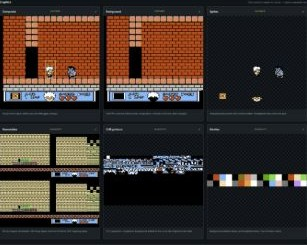
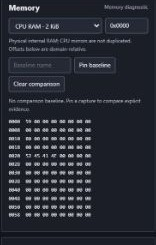
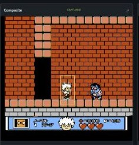
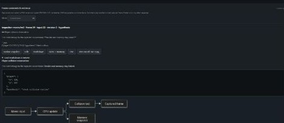

# NES REAPER - FCEUX

**NES REAPER - FCEUX** is an independent fork of [TASEmulators/fceux](https://github.com/TASEmulators/fceux), with an AI-ready NES reverse-engineering workspace. FCEUX's authors retain their credits and copyrights. NES REAPER adds the REA inspection service, browser interface, deterministic controls and game-specific collision helpers. It is not an official FCEUX release.

## Download NES REAPER - FCEUX for Windows

Download **NES-REAPER-FCEUX-v0.4.0-win-x64.zip** for Windows 10/11 x64. The portable package includes the emulator, Node runtime, REA workbench, launcher, required DLLs and licenses. [Windows ZIP](https://github.com/Bertzerker/NES-REAPER-FCEUX/releases/download/v0.4.0/NES-REAPER-FCEUX-v0.4.0-win-x64.zip) · [Release notes and source](https://github.com/Bertzerker/NES-REAPER-FCEUX/releases/tag/v0.4.0)

1. Extract the entire ZIP to a writable folder.
2. Double-click **Launch-NES-REAPER.cmd** and select your own ROM, or drag a ROM onto the launcher.
3. Open **http://127.0.0.1:8775/** in your browser. Use Codex's in-app browser when working in Codex.
4. The game starts paused. Use **Play** / **Step frame**; **Resume inspection** enables live views capped at two updates per second.

Only one FCEUX instance is allowed. Close FCEUX to stop the local inspector. No commercial ROMs, saves or user captures are distributed.

## What this fork adds

Version **v0.4.0** includes the sprite and tile catalog and tracked frame attachments. Click any crop to enlarge it.

| Feature | Cropped example |
| --- | --- |
| **Graphics and hardware diagnostics.** Inspect Composite, background and sprite samples from the old PPU, alongside copied nametable, CHR, palette and OAM views. The new PPU exposes Composite with reduced layer attribution. | <a href="docs/rea-features/graphics.jpg"></a> |
| **Pinned memory and execution.** Compare copied memory against a capture baseline. Pause, step with controller inputs, save or restore a checkpoint, and use bounded instruction traces or CPU watchpoints. The local API uses the browser’s capture IDs. | <a href="docs/rea-features/memory.jpg"></a> |
| **Collision helper.** Editable per-ROM profiles draw terrain probes and supported contact bounds. The Kid Dracula Japan profile covers replay-verified normal enemy contact. | <a href="docs/rea-features/collision.jpg"></a> |
| **FM2 and frame comments.** Open an FM2 and play, pause, step or change speed. Preserve the frame and its copied memory with a Markdown, JSON or Mermaid note. Export evidence or an annotated FM2 with the original inputs. | <a href="docs/rea-features/comments.jpg"></a> |
| **Sprite and tile catalog.** Name a sprite group or tile, append animation variants, isolate matches and follow an occurrence. Attach the pinned observation and catalog revision to a live or FM2 replay comment. The crop shows an actor from an attached diagnostic replay frame. | <a href="docs/rea-features/catalog.jpg"></a> |

Live inspection is demand driven and capped at two updates per second. Frozen and hidden inspection stops live polling.

[Workbench guide](rea/WORKBENCH.md) · [Sprite and tile catalog](rea/CATALOG.md) · [Specification](rea/SPEC.md) · [Run, build and API guide](rea/README.md) · [Movies and comments](rea/MOVIES.md) · [Game helpers](rea/HELPERS.md) · [Validation](rea/VALIDATION.md) · [Original upstream README](documentation/FCEUX-UPSTREAM.md) · [Upstream SDL build guide](documentation/README-SDL-upstream.txt)

## Build and package

From a Visual Studio C++ build-tools environment with a Windows SDK and Node.js:

```powershell
./rea/Build-REA.ps1
./rea/Start-REA.ps1 -Rom 'C:/path/to/game.nes'
./rea/Package-Windows.ps1 -Version 0.4.0
```

The build defaults to MSVC v145; pass `-Toolset v143` and `-MSBuild` as appropriate. Worker counts are capped. The packager verifies the local Windows x64 Node executable against its official checksum and includes its license. It copies only the release allowlist and tracked upstream resources, never the working saves/configuration directory. See [release packaging](rea/RELEASING.md).

## Upstream and license

Upstream base: `TASEmulators/fceux` commit `8cc753da0b8e6924089ed76ce6a2a93997492264`. Upstream history remains in this GitHub fork. FCEUX and these modifications are **GPL-2.0-or-later**; see [COPYING](COPYING). Lua, 7-Zip and Node.js retain their own licenses and notices. Releases include corresponding emulator source and the official 7-Zip source archive. Existing FCEUX functionality and credits remain available in the native application and source.
